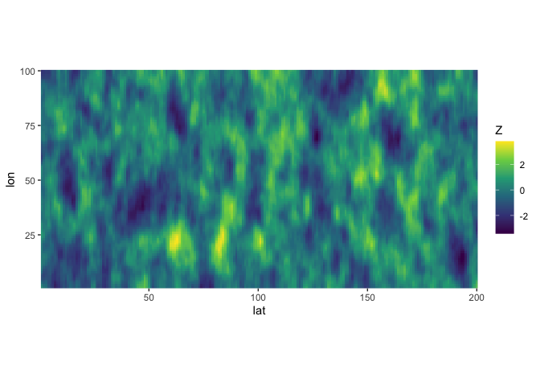
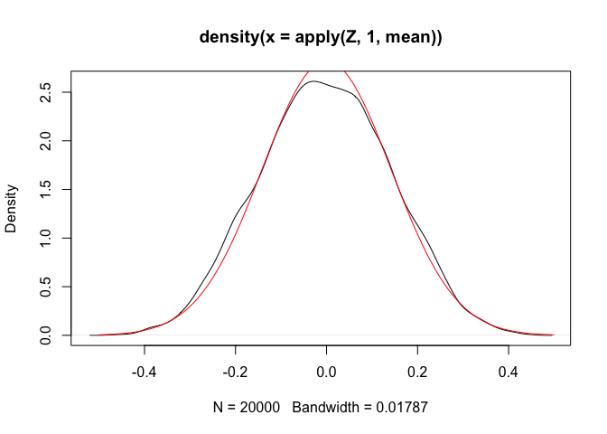
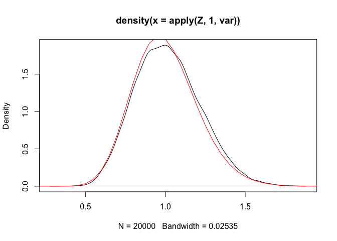

# stdmatern

This directory is for development of fast and memory-efficient code that
creates Matérn precision matrices that have been standardized so that
their inverse is a correlation matrix. The methods used in this code are
described in [a paper I am working
on](https://bggj.is/materneigenpaper/).

The package is still in very active development and should not be
considered a stable product yet. The package can be installed with

``` r
pak::pak("bgautijonsson/stdmatern")
```

``` r
library(stdmatern)
```

    Loading required package: Matrix

# Sampling spatial data

Here we sample 50 replicates of highly dependent spatial data on a
200x100 grid, i.e. there’s 20.000 observational locations.

``` r
start <- tictoc::tic()
dim1 <- 200
dim2 <- 100
rho1 <- 0.6
rho2 <- 0.9
nu <- 2
n_obs <- 50
Z <- rmatern_copula_eigen(n_obs, dim1, dim2, rho1, rho2, nu)
stop <- tictoc::toc()
```

    2.094 sec elapsed

``` r
tibble(
  Z = as.numeric(Z[, 1])
) |> 
  mutate(
    lat = rep(seq_len(dim1), each = dim2),
    lon = rep(seq_len(dim2), times = dim1),
  ) |> 
  ggplot(aes(lat, lon, fill = Z)) +
  geom_raster() +
  scale_fill_viridis_c() +
  coord_fixed(expand = FALSE)
```



``` r
stop$callback_msg
```

    [1] "2.094 sec elapsed"

On the plots below, the distribution of sample statistics are shown in
black while the theoretical distributions of standard normal variables
is shown in red.

``` r
Z  |> apply(1, mean) |> density() |> plot()
curve(dnorm(x, 0, 1 / sqrt(n_obs)), add = TRUE, from = -0.5, to = 0.5, col = "red")
```



``` r
apply(Z, 1, var) |> density() |> plot()
curve((n_obs - 1) * dchisq((n_obs - 1) * x, df = (n_obs - 1)), col = "red", from = 0, to = 5, add = TRUE)
```



# Normal density

The package implements a method for calculating the log-density of a
multivariate normal with appropriate precision matrix, defined as

$$
\mathbf{Q} = \left( \mathbf{Q}_{\rho_1} \otimes \mathbf{I_{n_2}} + \mathbf{I_{n_1}} \otimes \mathbf{Q}_{\rho_2} \right)^{\nu + 1}, \quad \nu \in \{0, 1, 2\},
$$

where $\nu$ is a smoothness parameter, $\otimes$ is the Kronecker
product and each $Q_\rho$ is a precision matrix corresponding to a
one-dimensional AR(1) process with unit marginal variance.

To evaluate the density of the random sample generated above we would
run:

``` r
tictoc::tic()
dens <- dmatern_copula_eigen(Z, dim1, dim2, rho1, rho2, nu) |> sum()
tictoc::toc()
```

    0.62 sec elapsed

## Version 0.4.0 (2026-09-29)

`make_standardized_matern()`, `matern_spectral()`, `dmatern_copula()`,
`rmatern_copula()` and `fit_matern_copula()` default to `method = "kronecker"`.
The standardised precision's eigenvectors are products of the two AR(1)
eigenvectors, so the marginal standard deviations, the copula quadratic form
and each draw are two small matrix products per field, O(N (n_x + n_y))
instead of O(N^2). At a 133 x 211 grid with 99 fields the sampler takes 0.18 s
instead of 24.1 s and one copula objective 0.13 s instead of 30.3 s. The
results equal the eigenpair forms to rounding (1e-13 relative for the
marginal standard deviations, 1e-10 per observation for the density, the same
per-eigenpair random numbers for a given seed). `method = "eigenpair"` keeps
the 2024 arithmetic as the reference form.

## Version 0.3.0 (2026-09-02)

The circulant, folded and Cholesky variants, `plot_matern()` and the 2024
benchmark were retired to `archive/retired-2026-09-02/` (no production caller;
see `notes/stdmatern-review-2026-09-02.html`). The package no longer links
fftw3 or a system nlopt: the fit reaches nlopt through `nloptr`'s registered
C callables. All numerical work is single-threaded and reproducible from a
seed. `fit_matern_copula()` reports `n_evals`, `converged` and `stop_reason`,
has no wall-clock cap, and accepts `method = "kronecker"` for an objective
that costs O(N (n_x + n_y) n) per evaluation instead of O(N^2 n).
`matern_spectral()` returns the standardised precision together with its half
log-determinant, marginal standard deviations and the two AR(1) eigen systems.
The production-path benchmark is `tools/bench.sh`.
